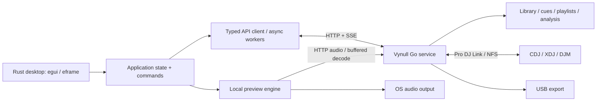

# Vynull native desktop frontend

Status: proposed · 2026-10-17 · implementation has not started

Build a native Rust application for preparing a DJ library and using it with
Vynull's connected hardware. The desktop app should feel familiar to a rekordbox
user: a dense track browser, a collection/playlist tree, a prominent waveform,
direct cue and grid editing, and visible player state.

The confirmed first-release scope is **library preparation, local preview,
Pro DJ Link, and USB export** (user decision, 2026-10-17). It includes browsing,
waveforms, cues, playlists, and connected hardware players. A full software mixing
engine would be a separate expansion.

“Native” here means a compiled Rust UI with native windows and GPU rendering,
without a browser runtime. Controls are custom drawn to maintain a consistent DJ
workspace across Linux, macOS, and Windows; file dialogs, menus, clipboard,
keyboard conventions, and window behavior integrate with each OS.

## Product decisions

| Decision | Proposal | Reason |
| --- | --- | --- |
| UI | `egui` + `eframe`, using the `wgpu` renderer | Good starting point for a dense table and interactive waveform; validate before committing |
| Existing engine | Keep the Go daemon as the library and hardware authority | Reuse analysis, imports, export, persistence, and the working Pro DJ Link stack |
| Boundary | Typed HTTP/JSON requests, SSE player updates, HTTP audio | These interfaces already exist; avoid Go/Rust FFI and a second implementation of the library |
| Installation | Bundle the Rust executable, Go service, and required helpers | Normal use must not require a terminal or a development environment |
| Default session | Local, offline-capable library preparation; Link enabled separately | Preparing music should work without Ethernet, decks, or a selected network interface |
| First playback model | One local preview deck; connected players displayed separately | Auditioning and preparing tracks fits the existing backend |
| Platforms | Linux x86_64, macOS arm64/x86_64, Windows x86_64 | These are release targets, not claims of current backend support |
| Branding | Vynull identity, original icons and layout details | Follow familiar workflows while retaining the project's identity |

The workflow reference is rekordbox's Collection and EXPORT mode: collection
browsing, configurable columns, preparation, USB export, and Link use. Its manual
distinguishes these from PERFORMANCE mode's software performance features.
See the [official manual, pages 7–40 and 60–117](https://cdn.rekordbox.com/files/20260409151936/rekordbox7.214_manual_EN.pdf).
The requirements below are proposals for Vynull, not a claim of feature parity.

## Existing foundation and actual gaps

This assessment comes from the checked-out source, not just the README. The
[OpenAPI document](../api/openapi.yaml) is the starting contract; handlers remain
the authority where schemas are incomplete.

| Area | Available now | Desktop work or backend gap |
| --- | --- | --- |
| Collection | Full track list, single-track detail, ETag, revision polling, metadata edits, ratings, colors, tags, relinking | Virtualized table, search index, selection model; scalable incremental refresh |
| Organization | Playlist/folder tree, smart rules, related tracks, history, hot cue banks | Native editors and drag/drop; validate ordering and batch changes |
| Preparation | Analysis, beat grids, grid adjustment, analysis lock, hot/memory cues, loops, waveform JSON/PNG | Interactive renderer, local transport, undo and concurrent-edit handling |
| Preview audio | `/api/audio/{trackID}` supports byte ranges; FFmpeg converts unsupported browser formats to cached WAV | Rust audio output, seekable buffering, timing validation, device changes |
| Players | `/api/events` pushes player/now-playing snapshots; load/link/unlink APIs; external-source metadata | Player UI, interpolation, stale-state handling, load confirmation |
| Imports | rekordbox XML/master.db/backup ZIP and Traktor NML; path remapping | Native import flow, dependency packaging, structured job results |
| USB | Export preview and collection/playlist/selection export | Destination discovery, reliable progress/cancellation, interrupted-write recovery |
| Service lifecycle | Headless CLI, loopback HTTP by default, diagnostics/version | Offline startup, readiness handshake, process ownership, service identity, data-directory locking |
| Portability | Release workflow builds Linux amd64/arm64 | Build and runtime validation for macOS/Windows, platform adapters and installers |

Specific implementation facts that affect the design:

- [Track listing](../../api/tracks.go) returns the entire collection, not paginated
  search results. The initial client can index a snapshot in a worker; repeatedly
  downloading it after every edit will not scale.
- [SSE](../../api/events.go) carries full player/now-playing snapshots, checked
  every 250 ms, with 15-second idle heartbeats. It does not currently publish
  library edits, job events, event IDs, or replayable deltas.
- [Audio](../../api/audio.go) may finish a full FFmpeg WAV conversion before
  returning bytes. A first preview can therefore need a visible preparation state.
- [Startup](../../config.go) currently requires `--interface` for normal serving;
  [main](../../main.go) resolves it before starting services. Offline preparation
  needs an explicit service mode and nil-safe API wiring.
- [master.db import](../../library/import_masterdb.go) discovers `python3`, uses
  Unix-style `bin/python3` virtualenv paths, and can install `sqlcipher3` at runtime.
  Desktop packaging must supply and locate a tested helper per platform.
- [Atomic file writes](../../internal/fsutil/atomic.go) use temp files, fsync, and
  rename. Verify replacement/durability behavior on Windows and removable media;
  this is not a multi-store transaction or an export recovery mechanism.
- Existing [modular-backend work](modular-backends.md) remains useful context,
  but completing that larger refactor is not a prerequisite for the desktop UI.

## Release scope

**Required for v1:** collection and playlist management; file/folder and supported
library imports; metadata, tag, rating and color edits; missing-file repair; one
local preview deck; waveform navigation; hot/memory cues and saved loops; grid
correction and analysis locking; related tracks; hardware player monitoring and
loading; history; USB export; settings and diagnostics. Hot cue bank management
and advanced CDJ menu configuration may follow the initial release, with imported
data preserved throughout.

**Later:** two-deck local transition rehearsal, a second browser pane, remote
daemon connections, richer phrase editing, and additional library formats.

**Separate product scope:** software DJ mixing, EQ/crossfader, master/cue routing,
tempo/key lock and synchronization, MIDI/HID mappings, DVS, effects, stems,
samplers, and streaming-service integrations. A pair of waveforms alone does not
provide this engine. If full PERFORMANCE-style operation is required, plan a
real-time audio engine and controller layer before estimating that release.

## Workspace and visual design

[Open the preparation workspace concept](native-frontend-wireframe.svg).
It is an original static design sketch with fictional track data, not an
implemented screen.

Three workspace presets share the same selection, collection, and job state:

1. **Prepare:** local preview and cue/grid tools above the browser.
2. **Browse:** compact preview strip; maximize the table for organization.
3. **Players:** connected hardware cards and waveforms above the browser.

```text
┌ VYNULL ─ Prepare / Browse / Players ─── Link status ─ Jobs ─ Settings ┐
│ Local preview: art · title · artist · BPM · key · elapsed/remaining  │
│ Overview waveform · cue markers · visible-range indicator           │
│ Zoomed waveform · beat grid · playhead · loop region                │
│ Play/Cue · beat jump · zoom · quantize │ Hot cues / Memory / Grid    │
├───────────────┬─────────────────────────────────┬───────────────────┤
│ Collection    │ Source name · search · filters  │ Selected track    │
│ Playlists     ├─────────────────────────────────┤ Info / Tags /     │
│ Smart lists   │ Artwork · title · artist · BPM  │ Related           │
│ History       │ Key · time · rating · color …   │                   │
│ Missing files │ Virtualized, sortable track list│ Collapsible       │
│ Devices       │                                 │ inspector         │
├───────────────┴─────────────────────────────────┴───────────────────┤
│ Track/selection count · total time · activity · connection state     │
└─────────────────────────────────────────────────────────────────────┘
```

At 1440×900 logical pixels, target a 48 px workspace bar, roughly 300 px preview
area, 220 px navigation tree, 280 px inspector, and 28 px status bar. Splitters
resize panels and persist per workspace. At 1280×720, collapse the inspector by
default and retain the table and essential transport controls. Support 100–200%
UI scaling; never hide controls behind a fixed pixel layout.

Use charcoal panels with subtle dividers, compact rows (26 px default, 22/32 px
options), a readable sans-serif face, and tabular numerals for BPM/time. Use
Vynull orange for active controls, with distinct semantic colors for warnings,
selection, cue slots, and deck identity. Waveform colors remain selectable as
blue, RGB, or three-band. Text, icons, and patterns must distinguish state without
depending solely on color. Show a strong keyboard-focus outline.

Use text-bearing toolbar actions and context menus. Keep settings, logs, and
import/export details in dedicated panels or dialogs so the main workspace stays
focused on music. Persist column visibility/order/width, sorting, pane sizes,
expanded folders, waveform zoom, and output device independently of library data.

## Interaction contract

### Browse and organize

- Single-click selects and updates the inspector. Double-click or Enter loads
  the local preview. Selection and preview-loaded track are separate IDs.
- Support Shift range selection, Ctrl/Cmd additive selection, Select All,
  keyboard navigation, and context menus. Selection survives sorting and filter
  changes by track identity; show hidden selected items in the count.
- Search title, artist, album, genre, label, comment, and tags. Combine search
  with BPM, key, rating, color, file-status, and analysis-status filters. Sort
  deterministically with track ID as a final tie-breaker.
- Drag files/folders from the OS to import. Drag tracks into a playlist to add
  them. Reorder a playlist only while viewing its explicit manual order; sorted
  views must not silently rewrite that order. Provide keyboard alternatives.
- Smart playlists use a rule editor backed by the Go evaluator. Their membership
  is computed; dragging into one should explain how to change its rules.
- Removal from a playlist and removal from the collection are separate commands.
  V1 collection removal leaves the audio file in place. Multi-track edits show
  mixed values and report failures for individual tracks.

### Preview, cues, and grids

- Preview states: empty, preparing, ready, playing, paused, seeking, and error.
  Provide play/pause, cue return/hold audition, elapsed/remaining time, output
  device, and volume. Selecting an audio output must not alter connected decks.
- Clicking the overview seeks; dragging its viewport pans the detail waveform.
  Wheel zoom anchors at the pointer. Beat jump supports selectable beat/bar steps.
- Distinguish the temporary transport cue from saved memory cues and hot cues.
  An empty hot-cue slot saves the current position; an occupied slot recalls it.
  Replacing/deleting a saved cue is an explicit action. Use backend slot limits.
- Quantize is visible and snaps against the authoritative beat grid. Provide
  unquantized placement, editable loop in/out points, cue colors, and a memory
  cue list. Cue names are deferred until they round-trip through persistence:
  `CueInfo.Label` exists, but the current `CueStoreAdapter` drops it.
- The Grid tab provides BPM entry, half/double BPM, time nudge, first-downbeat
  assignment, and lock/unlock. Do not imply support for arbitrary variable-tempo
  grid editing through the existing global-adjustment API.
- Preview an edit locally, commit once on gesture completion, and replace it
  with the server's canonical result. Failed writes remain visibly unsaved.
  Undo/redo covers supported cue, grid, metadata, and playlist operations; it
  does not claim to undo imports, exports, or physical hardware actions.
- With a text field focused, transport shortcuts must not intercept typing.
  Use platform modifiers and a remappable command map; document initial defaults
  rather than claiming exact rekordbox shortcut parity.

### Connected players

- Show one card per discovered player with device identity, source, track,
  artwork, BPM/pitch, play state, master/sync/on-air indicators, and waveform.
  Unknown state is visibly different from false. Adapt layout to discovered
  devices rather than assuming exactly two decks.
- A load action names the destination deck. Block replacement of a playing or
  on-air deck by default; any override is explicit. Recheck fresh state in the
  backend immediately before sending, while acknowledging hardware can change
  state after that check.
- An accepted HTTP load request means **sent**, not **loaded**. Confirm via a
  subsequent player snapshot matching source and track, or show a timeout.
- Hardware playheads are estimates based on observed beats and pitch. Correct
  on seeks/loops/state changes; freeze estimates on stale data. Do not use the
  animation clock as authoritative cue timing or a software synchronization clock.
- External USB/SD tracks are source-scoped and read-only unless a future API
  explicitly permits editing. Never map an external track to a local track by
  numeric ID alone.

### Import and USB export

- Import flow: select source → select supported content and path mapping → run
  with progress → review imported/skipped/missing/failed results. Support choosing
  files through a native dialog and adding local music through drag/drop.
- Relink flow previews old/new path mappings and affected counts before applying
  them. Preserve imported cue/grid data and surface missing dependency errors.
- Export flow: choose collection/playlist/selection → choose destination → review
  preview and merge/replace choice → write → verify result. Display unsupported
  tracks, missing files, required/available space, and filesystem constraints.
- Initial previews use existing export capabilities. Reliable cancellation and
  recovery require backend work before the UI advertises them: stage changes,
  publish the database last, retain recovery metadata, and test removal/power-loss
  scenarios. FAT/exFAT cannot be treated as a transactional filesystem.
- Discovery/eject are OS integrations. Device profiles must describe which export
  formats and hardware have been tested; avoid a blanket promise that every
  rekordbox-compatible device works.

## Runtime architecture



The Go service owns all durable music data and protocol behavior. Rust owns
presentation state, local preview, disposable caches, and OS integrations. The
frontend never writes `library.json`, cue stores, playlist files, or analysis
caches directly. It can keep its own versioned preferences and cached snapshots.

Proposed Rust workspace under `desktop/`:

```text
crates/app/          entry point, windows, workspace composition, themes
crates/client/       API models, requests, SSE, capabilities, error mapping
crates/model/        identities, state updates, command/undo model
crates/widgets/      table, tree, waveforms, cue/grid controls, player cards
crates/preview/      audio preparation, output, seeking, playback clock
crates/platform/     dialogs, menus, process lifecycle, volumes, preferences
```

Keep the model and client independent of egui. Start with the fewest practical
crates; these are dependency boundaries, not a requirement for six empty packages.
Use an async worker runtime for HTTP and background tasks, bounded channels into
the UI, and cancellation/generation IDs for stale searches and track loads. Never
decode audio, parse large JSON responses, or perform disk/network I/O in a UI frame.

Identity must include the backend/library instance as well as numeric track ID.
External media also needs source-device/slot and a media/session generation so
replacing a USB stick cannot reuse stale artwork or waveform data.

### Service lifecycle

Managed mode starts a bundled service with an explicitly selected data directory,
an OS-held exclusive library lock, loopback binding, and a protected readiness
channel carrying port, service identity, API version, and a per-session token.
These are new requirements. The existing `/api/version` reports build metadata;
it is not capability negotiation or a verified readiness handshake.

An existing local daemon can be attached after checking identity and protocol
compatibility. Never start a second writer for the same library or silently attach
to whatever happens to occupy port 9443. Distinguish owned and attached services.

Library-only startup opens no Link/NFS listeners and does not need an interface.
Link activation selects an interface and starts the hardware services separately.
Library features remain available after cable loss, sleep/resume, or Link failure.
This requires lifecycle changes in Go, not just a disabled UI button.

Closing an attached client leaves its daemon running. A managed session can stop
its service when idle; if decks or jobs are active, explain the effect and offer
to keep serving. Do not automatically restart a failed service into active deck
use without showing the interruption. Keep logs accessible on startup failures.

All desktop API requests, including audio and SSE, use the local session token;
keep it out of URLs/logs. Define the trusted-origin behavior for the existing web
UI when adding this mode. Remote network access is a later feature requiring an
explicit authentication/transport design, not an automatic consequence of HTTP.

### Preview engine and waveform rendering

Begin the playback spike with [Rodio](https://github.com/RustAudio/rodio) and its
decoder support. Use the existing audio endpoint and a seekable disk-backed
buffer; HTTP streaming is not automatically a seekable decoder input. Keep the
audio thread independent of rendering and network fetching. Use a bounded PCM
buffer, and derive the playhead from consumed audio frames with measured output
latency, rather than from UI elapsed time.

Validate MP3 encoder delay, AAC priming, VBR seeking, resampling, AIFF/FLAC/WAV,
and end-of-track behavior against the timebase used by Go analysis. Force the
backend WAV path where necessary for agreement. A first conversion may be slow;
show progress/preparation and allow abandoning that request without freezing the
UI. Do not promise instant seeking or sample-accurate looping until measured.
If Rodio cannot meet cue/loop behavior, replace the internals of `preview` with
an explicit decoder/PCM engine; the rest of the app should not change.

Fetch overview first and detailed data only for visible/loaded tracks. Convert
waveform JSON off-thread to packed buffers; create cached multiresolution geometry
and redraw the playhead independently. Use supplied sample rates and beat times,
not guessed BPM spacing or hard-coded rates. Key caches by backend identity,
track/source identity, analysis revision/ETag, style, and level of detail. Bound
CPU/GPU/disk caches. Row thumbnails must not trigger unbounded lazy analysis.

## API work plan

Keep existing endpoint behavior for the web UI. The following are proposed
additions; names and envelopes must be finalized in OpenAPI before use.

| Priority | Change | Required behavior |
| --- | --- | --- |
| Foundation | Capabilities/identity handshake and library-only mode | Advertise API protocol, library identity, supported operations, and optional features; guard Link-only handlers when inactive |
| Foundation | Structured errors | Stable error codes, useful message, field errors/retryability; tolerate legacy text errors in the adapter |
| Editing | Per-resource revisions and conditional mutations | Conflict detection for cues, grids, metadata, and playlist order; validation before mutation; persistence failures returned to client |
| Editing | Transactional operations where needed | Batch outcomes and narrowly scoped atomic updates; do not implement multi-field undo as unrelated writes |
| Scale | Library change notifications + incremental reads | Cover metadata, cues, tags, playlists, and analysis; deletions and full-resync signal; sequence/generation handling |
| Jobs | Shared import/analysis/export job model | Job ID, phases, item counts, result/errors, supported cancellation boundaries, reconnect status, bounded result retention |
| Hardware | Guarded load operation | Fresh target/source checks, request ID, explicit sent/confirmed/timeout states; never blindly retry a load |
| Packaging | Managed-service control | Ready/shutdown protocol, ownership, exclusive library lock, credential handling, predictable helper discovery |

The first read-only prototype can use today's full snapshot, ETag, revision
polling, and SSE. A changed global revision can invalidate the snapshot; it cannot
identify individual changes. Before broad editing ships, make revision coverage
complete or refresh the affected resources explicitly. Undo must refuse to
overwrite a later edit from the web UI or hardware. Do not automatically retry
non-idempotent writes after an ambiguous timeout; resynchronize first.

On SSE reconnect, take the current full player snapshot. There is no current
event replay. Track stream liveness separately from player freshness: an idle
stream legitimately sends only heartbeats. On a live stream, an absent player is
disconnected; on a broken stream, freeze all live estimates and label stale state.

Search initially uses an in-memory index built off-thread from the track snapshot.
Only visible rows render. Add server-side query/pagination if the 100k-track
benchmark misses its startup/memory goals; do not maintain contradictory sorting
or smart-playlist semantics in Rust and Go. Bind query results and selections to
a known library generation.

## Toolkit decision and feasibility gate

The `egui` recommendation is an engineering judgment, not a completed benchmark.
[eframe supports Linux, macOS and Windows](https://github.com/emilk/egui), and
[egui_extras table rows](https://docs.rs/egui_extras/latest/egui_extras/struct.TableBody.html#method.rows)
only build visible row content. These fit the two central widgets. Custom visual
polish, tree/table semantics, drag/drop, and OS integration still require work.

| Candidate | Fit | Decision |
| --- | --- | --- |
| egui / eframe | Custom drawing and dense interactive tools; virtualized table support | First prototype |
| Iced | Reactive message/state architecture, custom widgets, GPU and software renderers | Fallback candidate if the prototype exposes layout/interaction limitations |
| Slint | Declarative UI with Rust integration and designer-oriented tooling | Consider if a declarative UI workflow becomes a priority |

See the [Iced project](https://github.com/iced-rs/iced) and
[Slint project](https://slint.dev/) for their supported capabilities. Pin tested
versions after the spike instead of designing against unspecified latest APIs.

The prototype may connect to today's local API without these new managed-service
features. The packaged product requires the updated service contract; an old
daemon must produce a clear compatibility message rather than an assumed match.

Build one vertical slice before settling the toolkit: 100k synthetic tracks,
resizable columns, selection, editable text with IME, tree drag/drop, a zoomable
waveform, local audio, native dialogs, clipboard, and keyboard focus. Exercise it
on all three OS families at multiple DPI scales and on integrated graphics.

[egui has AccessKit integration](https://github.com/emilk/egui/blob/main/docs/accessibility.md),
but that alone does not make custom controls accessible. Validate screen-reader
names, table navigation, focus order, transport controls, and alternate numeric
cue/grid editing with NVDA, VoiceOver, and Orca. A material accessibility failure
is a toolkit decision input, not something to defer until the interface is built.

## Platform delivery

| Platform | Work to validate before claiming support |
| --- | --- |
| Linux | X11/Wayland, audio backend/device selection, portal file dialogs, desktop packaging, Link socket/port setup, optional MPRIS |
| macOS | arm64/x86_64 service and helpers, native menus, output device changes, network/file permissions, signed/notarized app bundle |
| Windows | Service/helper builds, drive letters/UNC and Unicode paths, file replacement semantics, process shutdown, firewall/network setup, installer and signing |

The existing Linux release pipeline does not establish portability. Audit MPRIS,
signals/shutdown, network discovery and broadcasts, NFS path mapping, helper
executable discovery, FFmpeg, Python/SQLCipher, and external volume handling. Add
platform adapters/build tags where required; do not assume each item is already a
compile failure. Full packaged library preparation is required on all targets;
Link support is tracked separately by OS and tested hardware/firmware.

Install/update frontend and managed backend as a tested pair. Gate incompatible
schema changes, back up before migrations, and prevent downgrade onto an
incompatible library. Reuse existing data only by explicit directory selection;
frontend upgrades must not reimport or reset the user's library.

## Milestones and acceptance

These are ordered delivery gates, not calendar estimates. Portability and preview
timing are too uncertain for a useful fixed schedule before the first two gates.

| Gate | Deliverable | Exit criteria |
| --- | --- | --- |
| 0: feasibility | Native vertical slice + Go portability audit | Three OS windows, 100k-row table, waveform, representative audio seeks, accessibility checks; chosen toolkit and documented blockers |
| 1: foundation | Managed service + offline collection | Launch without network/decks; library identity/lock; reconnect; browse/search a real library; installers smoke-tested on all targets |
| 2: preparation | Preview, cues, grids, editing, playlists/import | Import → find → preview → correct grid → save cues → organize → restart with edits intact; conflicts and failures recover correctly |
| 3: hardware/export | Player monitoring/loading and USB flow | Load confirmation, external source isolation, reconnect tests; export/import round trip and actual device validation |
| 4: release | Packaging, tuning, accessibility, diagnostics | Required workflows pass on each claimed OS; documented device matrix and limitations; signed artifacts where applicable |

The first implementation task should be gate 0: a disposable `desktop/` prototype
using captured API fixtures plus a test library. It should not migrate production
libraries or alter the Pro DJ Link serving path.

Proposed performance budgets, to validate on a recorded baseline laptop (four
cores, 16 GB RAM, SSD, integrated GPU) at 1440×900 logical pixels:

- 100k metadata rows: cached collection interactive within 2 seconds after
  service readiness; a fresh full snapshot/index within 5 seconds. Report both
  service startup and client initialization separately.
- Search/filter results within 100 ms p95 after the last keystroke; initial
  debounce no more than 75 ms. Sorting must not stall rendering.
- 60 Hz waveform/scroll rendering with p95 frame work below 16.7 ms; idle windows
  repaint only for meaningful state changes. Measure CPU/energy at idle as well.
- Warm local preview start/seek audible within 100 ms p95; decoded cue placement
  agrees with the analysis timeline within 5 ms on fixtures. Measure audible
  output latency separately. Cold conversion has a separate reported duration.
- Rust client memory under 500 MiB for the reference collection and one loaded
  waveform, excluding a separately reported service footprint. Cache growth is
  bounded; artist/artwork scrolling must not trigger an analysis storm.

Validation should focus on user-visible failures: source-ID collisions, stale
responses after switching tracks, concurrent edits, missing/remapped files,
audio-device removal, SSE loss, service restart, malformed data, export disk-full
and removal, and shutdown with active decks/jobs. Use API contract fixtures and
focused Rust model tests, platform UI smoke tests, and performance captures.
Protocol/export changes still require actual hardware checks with recorded model
and firmware, as described in [CONTRIBUTING](../../CONTRIBUTING.md).

## Decisions to revisit after review

1. Confirm whether all three platforms must ship together or can preview in
   sequence; keep cross-platform feasibility in gate 0 either way.
2. Choose a visual density and workflow baseline from the concept; this draft
   proposes familiar operation rather than pixel-for-pixel reproduction.
3. Choose representative libraries, audio interfaces, and deck/firmware targets
   for acceptance. A supported matrix must be based on those tests.
